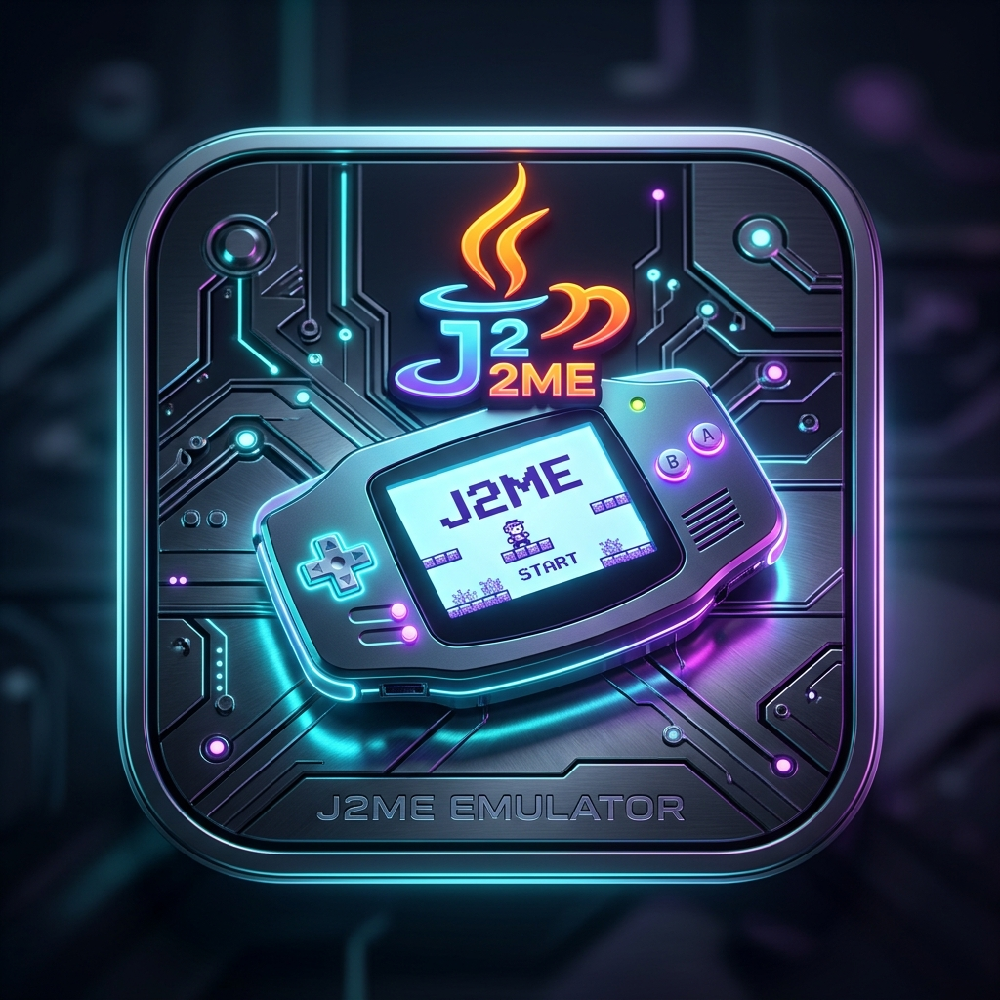

# J2ME Retro Player Pro 🎮
> **Trình giả lập game Java J2ME (.jar) chạy Offline 100% trên trình duyệt web, hỗ trợ cài về màn hình chính (PWA) và tự động toàn màn hình ngang.**



---

## 🌟 Tính Năng Nổi Bật

1. **⚡ Chạy Offline 100% (PWA - Progressive Web App)**:
   - Sử dụng **Service Worker** (`sw.js`) lưu bộ nhớ đệm (CacheStorage) toàn bộ mã nguồn máy ảo Java (JVM), thư viện âm thanh MIDI/AMR và giao diện.
   - Khi không có mạng Internet (hoặc bật chế độ máy bay), ứng dụng vẫn khởi động và chơi game bình thường.

2. **📱 Cài Đặt Về Màn Hình Chính (Add to Home Screen)**:
   - Hỗ trợ đầy đủ tiêu chuẩn **PWA Manifest** (`manifest.webmanifest`).
   - **Android / Chrome / Edge**: Nhấn nút **"📱 Cài Đặt App"** ngay trên thanh menu để cài app như ứng dụng gốc.
   - **iOS / Safari (iPhone / iPad)**: Nhấn nút **Chia sẻ** (biểu tượng ô vuông mũi tên ⎋) trên thanh công cụ Safari -> Chọn **"Thêm vào MH chính"** (*Add to Home Screen*).

3. **📂 Chỉ Cần Import File .JAR**:
   - Kéo & thả trực tiếp file `.jar` vào vùng Dropzone hoặc bấm nút chọn file từ thiết bị.
   - Tự động giải nén thông tin game (`META-INF/MANIFEST.MF`), trích xuất tên game, hãng sản xuất và icon game gốc.
   - Lưu trữ game vĩnh viễn vào trình duyệt thông qua **IndexedDB**, không lo mất dữ liệu save (RMS) khi đóng tab.

4. **🔄 Toàn Màn Hình Ngang (Fullscreen Landscape)**:
   - Tự động kích hoạt chế độ **Toàn Màn Hình** (`requestFullscreen`) và khóa hướng xoay **Ngang** (`screen.orientation.lock('landscape')`) ngay khi bấm vào game.
   - Hỗ trợ nút **"🔄 Giả lập xoay ngang"** (CSS 90° rotation matrix) cho các thiết bị như iPhone/Safari không hỗ trợ API khóa xoay.

5. **🎮 Hệ Thống Phím Ảo Tiện Lợi (Landscape Virtual Gamepad)**:
   - **Cụm bên trái**: Phím mềm trái (`L / MENU`), Cần điều hướng 8 chiều (`D-PAD`) hỗ trợ vuốt ngón tay mượt mà, phím Gọi (`GỌI`).
   - **Cụm bên phải**: Phím mềm phải (`R / TRỞ VỀ`), Phím hành động to (`OK / 5 / FIRE`), phím Bắn phụ, phím Hủy (`✕`).
   - **Bàn phím số trượt (`⌨ 123`)**: Mở nhanh cụm phím số cổ điển (1-9, *, 0, #) cho các tựa game nhập vai, chiến thuật.
   - Hỗ trợ **Rung phản hồi xúc giác** (Haptic Vibration) khi chạm vào phím.
   - Thanh điều khiển HUD nổi: Tùy chỉnh độ mờ phím ảo, tắt/bật âm thanh, thoát về thư viện.

6. **⌨️ Hỗ Trợ Bàn Phím Cứng & Tay Cầm Gamepad**:
   - **Bàn phím PC/Laptop**:
     - Di chuyển: Mũi tên (`↑ ↓ ← →`) hoặc `W`, `A`, `S`, `D`
     - Chọn / Bắn: `Enter`, `Space`, `J`
     - Menu trái: `Q`, `F1`
     - Trở về phải: `E`, `K`, `F2`
     - Bàn phím số: Các phím số `0-9`, `*`, `#`
     - Thoát: `Escape`
   - **Tay cầm Gamepad (Bluetooth / USB)**: Tự động nhận diện Xbox, PlayStation, tay cầm Bluetooth với cần Analog, D-Pad, các nút A/B/X/Y, L1/R1.

7. **🕹️ Game Mẫu Có Sẵn**:
   - Tích hợp sẵn nút tải nhanh 1-chạm các tựa game huyền thoại: **Bounce Tales**, **Plants vs Zombies**, **Need For Speed**, **City Bloxx**.

---

## 🚀 Hướng Dẫn Sử Dụng & Khởi Chạy

### Cách 1: Chạy máy chủ tĩnh cục bộ (Khuyên dùng)
Do trình duyệt hạn chế bảo mật khi chạy qua giao thức `file://`, bạn nên mở thư mục bằng một HTTP Server nhẹ:

```bash
# Bằng Python (Có sẵn trên macOS / Linux / Windows)
python3 -m http.server 8080

# Hoặc bằng Node.js npx
npx serve .
```
Sau đó truy cập: `http://localhost:8080` (hoặc mở trên điện thoại cùng mạng Wi-Fi: `http://<IP-may-tinh>:8080`).

---

## 📁 Cấu Trúc Dự Án

```
j2me/
├── index.html            # Giao diện chính: thư viện game, kéo thả import JAR, cài đặt PWA
├── main.html             # Màn hình chơi game toàn màn hình ngang & bàn phím ảo
├── manifest.webmanifest  # Cấu hình PWA để cài app vào màn hình chính
├── sw.js                 # Service Worker xử lý bộ nhớ đệm Offline 100%
├── js/
│   ├── app.js            # Quản lý thư viện IndexedDB, import file JAR, modal fullscreen
│   └── player-controls.js# Quản lý phím ảo cảm ứng, xoay màn hình, Gamepad, phím cứng
├── style/
│   ├── app.css           # Giao diện Cyberpunk/Retro sang trọng cho Dashboard
│   └── player.css        # Giao diện HUD toàn màn hình ngang cho Game Player
├── bld/                  # Bộ nhân máy ảo Java J2ME Web (native.js, j2me.js, main-all.js)
├── config/               # Cấu hình tham số máy ảo JVM
├── libs/                 # Thư viện âm thanh WebAudio TinySynth (MIDI) & AMR
├── java/                 # Các tệp thư viện chuẩn Java (classesold.jar, classes2.jar, classes.jar)
├── jar/                  # Thư mục chứa game mẫu (.jar)
└── img/                  # Biểu tượng ứng dụng (icon-192.png, icon-512.png)
```

---

## 📜 Bản Quyền & Giấy Phép
Dự án được xây dựng dựa trên mã nguồn mở máy ảo J2meJS / Mozilla j2me.js, được tinh chỉnh toàn diện về giao diện, hỗ trợ PWA offline, và tối ưu toàn màn hình ngang.
